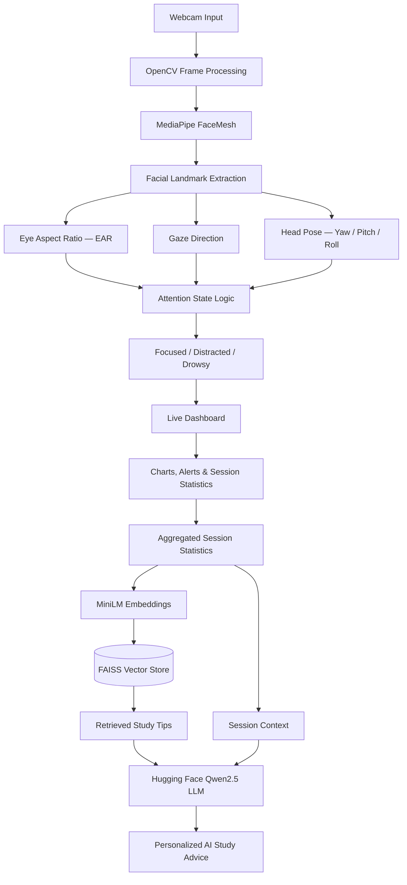

# 🚀 BlinkSense — Real-Time Focus & Drowsiness Detection

<p align="center">
  <strong>An AI-powered attention monitoring system that detects focus, distraction, and drowsiness in real time using a webcam.</strong>
</p>

<p align="center">
  
  
  
  
  
  
  
</p>

---

## 📌 Overview

**BlinkSense** is a real-time attention and drowsiness monitoring application designed to help users understand and improve their study and work habits.

Using a standard webcam, the system analyzes facial landmarks, eye movements, gaze direction, and head orientation to classify the user's attention state as:

- 🟢 **Focused** — The user appears attentive and engaged.
- 🟡 **Distracted** — The user's gaze or head orientation suggests reduced attention.
- 🔴 **Drowsy** — Eye-closure patterns indicate possible signs of sleepiness.

Beyond computer vision, BlinkSense integrates a Retrieval-Augmented Generation (RAG) powered AI study coach that analyzes session statistics and retrieves relevant study tips to generate personalized recommendations.

Built during an individual hackathon at **Nut an Maharashtra Institute of Engineering and Technology**.

## ✨ Key Features

- 👁️ **Real-Time Eye Tracking:** Uses Eye Aspect Ratio (EAR) to monitor eye openness and detect blinking patterns.
- 😴 **Drowsiness Detection:** Uses PERCLOS-based analysis to identify prolonged eye closure and potential fatigue.
- 👀 **Gaze Direction Detection:** Analyzes facial landmarks to estimate the user's gaze direction.
- 🧭 **3D Head Pose Estimation:** Calculates yaw, pitch, and roll to understand head orientation, with a live 3D head visualization.
- 🚦 **Attention Classification:** Categorizes the user's state into Focused, Distracted, or Drowsy.
- 🔊 **Audio Alerts:** Provides audio notifications when distraction or drowsiness is detected.
- 📊 **Live Analytics Dashboard:** Displays attention scores, focus streaks, and score-over-time charts.
- 📁 **Session Export:** Allows users to export session statistics in CSV format.
- 🎓 **AI Study Coach:** Uses session statistics, FAISS retrieval, and a Hugging Face language model to generate personalized study recommendations.
- 🔒 **Privacy-Focused Processing:** Processes webcam frames locally and sends only aggregated session statistics to the AI coach.

## 🏗️ System Architecture

BlinkSense follows a modular architecture consisting of a real-time computer vision pipeline and an AI-powered recommendation pipeline.



## 🔄 How It Works

### 1. Webcam Capture

The application captures real-time video frames from the user's webcam using OpenCV.

### 2. Facial Landmark Detection

MediaPipe FaceMesh identifies facial landmarks, providing the foundation for eye tracking, gaze estimation, and head-pose analysis.

### 3. Eye and Attention Analysis

The system analyzes:

- Eye Aspect Ratio (EAR) for blink and eye-closure detection.
- PERCLOS for estimating the proportion of time the eyes remain closed.
- Gaze direction for detecting potential visual distraction.
- Head orientation using yaw, pitch, and roll.

### 4. Attention Classification

The extracted metrics are passed through the attention-state logic to classify the user's current state.

### 5. Live Dashboard

The Flask-powered web interface displays real-time attention metrics, focus streaks, charts, alerts, and a 3D head visualization.

### 6. AI-Powered Study Coaching

At the end of a session:

1. Session statistics are collected.
2. MiniLM generates embeddings for the relevant study tips.
3. FAISS retrieves relevant recommendations.
4. Retrieved study tips and session statistics are provided to the Qwen2.5 language model through Hugging Face.
5. The AI coach generates personalized study suggestions.

## 🧠 Engineering Highlights

### 1. Combining Multiple Attention Signals

Instead of relying on a single facial feature, the application combines eye behavior, gaze direction, and head orientation to estimate attention states.

### 2. Real-Time Computer Vision

MediaPipe FaceMesh provides facial landmark information that can be used to calculate eye and head-related metrics continuously.

### 3. RAG-Based Personalized Coaching

The AI coach combines session-specific information with retrieved study recommendations rather than generating advice without supporting context.

### 4. 3D Head Pose Visualization

Three.js provides a live 3D visualization of head orientation, making yaw, pitch, and roll easier to understand.

### 5. Privacy-Aware AI Integration

Webcam frames remain on the local processing pipeline. Only aggregated session statistics are sent to the external language model for personalized recommendations.

## 🛠️ Tech Stack

| Category | Technology | Purpose |
|---|---|---|
| Programming Language | Python 3.12 | Core application logic |
| Computer Vision | OpenCV | Webcam capture and image processing |
| Facial Analysis | MediaPipe FaceMesh | Facial landmark detection |
| Numerical Processing | NumPy | Mathematical calculations |
| Backend | Flask | Application server and API |
| Embeddings | Sentence Transformers (MiniLM) | Text embedding generation |
| Vector Search | FAISS | Semantic retrieval |
| LLM | Qwen2.5 via Hugging Face | Personalized AI recommendations |
| 3D Visualization | Three.js | Live head-pose visualization |
| Frontend | HTML, CSS, JavaScript | Interactive dashboard |
| Data Export | CSV | Session data export |

## 🚀 Getting Started

Follow these steps to run BlinkSense locally.

### Prerequisites

- Python 3.12
- Git
- A working webcam
- Internet connection for model downloads and Hugging Face inference
- A Hugging Face access token

### 1. Clone the Repository

Replace `AsyncCoder-10` with your GitHub username.

```bash
git clone https://github.com/AsyncCoder-10/BlinkSense.git
cd BlinkSense
```

### 2. Create a Virtual Environment

**Windows — Command Prompt**

```bat
python -m venv venv
venv\Scripts\activate
```

**Windows — PowerShell**

```powershell
python -m venv venv
.\venv\Scripts\Activate.ps1
```

**macOS / Linux**

```bash
python3 -m venv venv
source venv/bin/activate
```

### 3. Install Dependencies

```bash
python -m pip install --upgrade pip
pip install -r requirements.txt
```

### 4. Configure Environment Variables

Create a `.env` file in the root directory.

```env
HF_TOKEN=your_huggingface_token_here
```

Generate your access token from the [Hugging Face Settings](https://huggingface.co/settings/tokens).

### 5. Run the Application

```bash
python app.py
```

Open your browser and navigate to:

**http://127.0.0.1:5000**

Allow webcam access when prompted by your browser.

<p align="center">
  <a href="https://github.com/user-attachments/assets/80606a20-a7aa-431f-b23d-b37eb4c25394">
    <strong>▶️ Watch BlinkSense Demo</strong>
  </a>
</p>


## 📊 Dashboard & Analytics

BlinkSense provides a real-time dashboard to help users understand their attention patterns.

| Feature | Description |
|---|---|
| Attention Score | Displays the current attention score |
| Focus Streak | Tracks consecutive periods of focused activity |
| State Classification | Displays Focused, Distracted, or Drowsy |
| Head Pose | Displays yaw, pitch, and roll |
| 3D Head Model | Visualizes head orientation |
| Score History | Shows attention score changes over time |
| Audio Alerts | Provides notifications for detected states |
| CSV Export | Downloads session statistics |

## 🎓 AI Study Coach

The integrated RAG-based study coach transforms session analytics into actionable study recommendations.

**RAG Pipeline:**

```text
Session Statistics
       |
       v
MiniLM Embeddings
       |
       v
FAISS Vector Search
       |
       v
Relevant Study Tips
       |
       v
Session Context + Retrieved Tips
       |
       v
Qwen2.5 via Hugging Face
       |
       v
Personalized Study Recommendations
```

This approach combines retrieved knowledge with the user's session statistics to produce context-aware feedback.

## 🔐 Privacy & Security

Privacy is an important part of BlinkSense's design.

- Webcam frames are processed locally.
- Raw video frames are not sent to the LLM.
- Only aggregated session statistics are sent for AI-powered recommendations.
- Hugging Face credentials are stored in environment variables.
- Webcam permissions are controlled through the browser.

> **Disclaimer:** BlinkSense is an experimental productivity and wellness tool. Its attention and drowsiness classifications are estimates, not medical diagnoses or validated measurements of cognitive performance. Do not use it for driver monitoring, workplace surveillance, or other safety-critical decisions.

## 🔮 Future Roadmap

- [ ] **Advanced Attention Analytics:** Add weekly and monthly attention reports.
- [ ] **Adaptive Study Sessions:** Recommend personalized study and break intervals.
- [ ] **Improved Drowsiness Detection:** Explore temporal models for more robust fatigue estimation.
- [ ] **AI Study Planner:** Generate personalized study schedules based on attention patterns.
- [ ] **Multi-User Support:** Introduce individual session profiles and analytics.
- [ ] **Cloud Dashboard:** Add secure session history and analytics synchronization.
- [ ] **Model Optimization:** Improve real-time inference performance.
- [ ] **Dockerization:** Package the application for easier deployment.
- [ ] **Automated Testing:** Add tests for eye tracking, classification, and RAG retrieval.

## 🤝 Contributing

Contributions, ideas, and suggestions are welcome.

1. Fork the repository.
2. Create a feature branch.
3. Implement and test your changes.
4. Submit a pull request with a description of your improvements.

## 📄 License

Choose an appropriate open-source license and add the corresponding `LICENSE` file before distributing the project.

---

<p align="center">
  <strong>Built with Python, OpenCV, MediaPipe, Flask, FAISS, Hugging Face, and Three.js.</strong>
</p>

<p align="center">
  ⭐ If you find BlinkSense useful, consider giving the repository a star!
</p>
